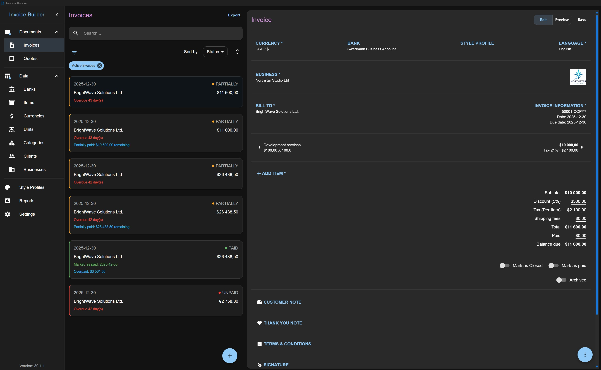
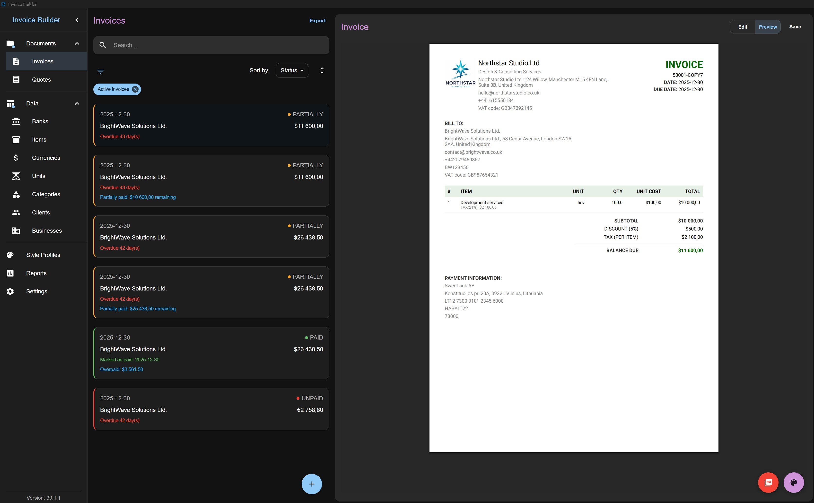
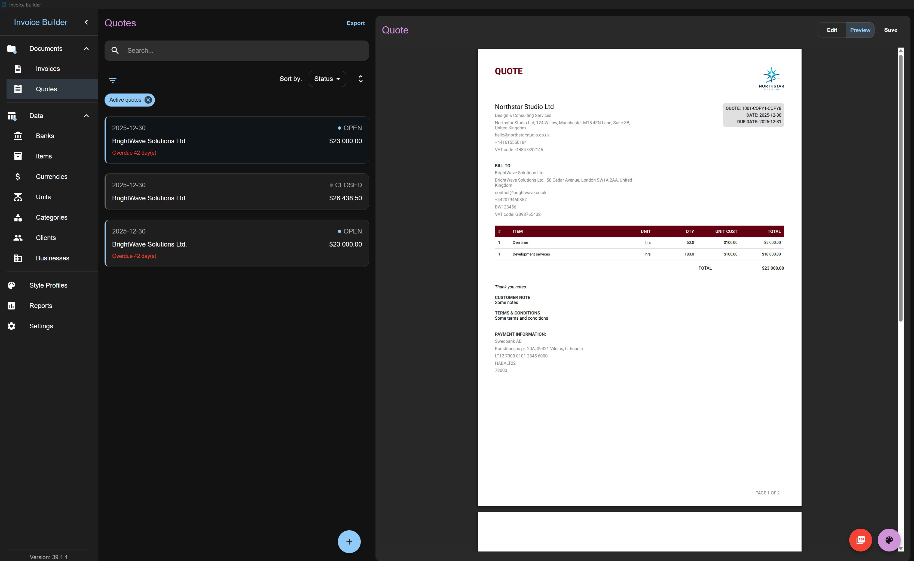

# Invoice Builder

[](https://invoice-docs-sauravdnj.vercel.app/)
[](LICENSE)
[](https://invoice-docs-sauravdnj.vercel.app/docs/installation/vercel/)


[](https://github.com/SauravDnj/invoice/pkgs/container/invoice)

Invoice Builder is an **offline-first, open-source invoicing and quoting application** for freelancers and small businesses. No accounts, no cloud, no subscriptions - your data stays on your machine in a database file you own, with an optional self-hosted web/Docker mode for multi-device access, or a hosted web deployment on Vercel with PostgreSQL.

> This repository is based on [piratuks/invoice-builder](https://github.com/piratuks/invoice-builder) by Evaldas L., used under the MIT License. It adds a Vercel deployment mode (serverless API + hosted PostgreSQL).

> **⚠️ One-time upgrade notice for version 3.0.2**
> Before upgrading, back up each existing database and make sure it completed migrations through version 2.10.0. Version 3.0.2 initializes new databases from a consolidated schema and does not include the historical migration chain, so databases with incomplete migrations are not upgraded. This applies to Electron, manual, and web/Docker upgrades.





## What it does

- Create and manage **Invoices** and **Quotes** with live PDF preview, A4/Letter formats, and a drag-and-drop Visual Layout Builder
- Manage Businesses, Clients, Banks, Items, Categories, Units, and Currencies, each with XLSX import/export
- Flexible financials: surcharges, discounts, shipping, inclusive/exclusive tax, partial payments, and document states
- Export invoices as UBL 2.1 / Peppol BIS Billing 3.0 or XRechnung XML for compliant e-invoicing
- Native receipt printing (desktop) and browser print-to-PDF receipts (web/Docker)
- Full database backup/restore, JSON export/import, and per-document data snapshots for historical accuracy
- Runs as a desktop app (Windows, Linux, macOS) backed by SQLite, self-hosted via Docker with SQLite or PostgreSQL, or on Vercel with PostgreSQL

## Quick start

**Vercel:** deploy the web app with a hosted PostgreSQL database (for example Neon) and optional password protection. See [Self-Hosting (Vercel)](https://invoice-docs-sauravdnj.vercel.app/docs/installation/vercel/).

**Desktop:** this repository does not publish desktop builds yet. Download the latest desktop build from the original project's [Releases](https://github.com/piratuks/invoice-builder/releases).

**Docker:**

Install Git and Docker with the Compose plugin, then clone the repository to obtain the Compose file:

```bash
git clone https://github.com/SauravDnj/invoice.git
cd invoice
docker compose pull
docker compose up -d
```

Then open [http://localhost:3001](http://localhost:3001) in your browser and create or connect a database. See [Quick Start](https://invoice-docs-sauravdnj.vercel.app/docs/installation/quick-start/) and [Self-Hosting (Docker)](https://invoice-docs-sauravdnj.vercel.app/docs/installation/docker/) for details.

## Documentation

Full documentation is published at [invoice-docs-sauravdnj.vercel.app](https://invoice-docs-sauravdnj.vercel.app/):

- [Installation](https://invoice-docs-sauravdnj.vercel.app/docs/installation/): requirements, desktop install, Docker and Vercel self-hosting, quick start
- [Guides](https://invoice-docs-sauravdnj.vercel.app/docs/guides/): screen-by-screen walkthrough, from database creation to layouts and e-invoices
- [Development](https://invoice-docs-sauravdnj.vercel.app/docs/development/): running locally, project structure, core stack, database schema

## Questions and ideas

Bugs, feature requests, and questions go in [Issues](https://github.com/SauravDnj/invoice/issues).

## Development

Invoice Builder is an Electron + React app with an optional Node.js webserver, using SQLite or PostgreSQL for storage. See [Running Locally](https://invoice-docs-sauravdnj.vercel.app/docs/development/running-locally/) to set up a dev environment, and [CONTRIBUTING.md](CONTRIBUTING.md) before opening a PR.

## License

Invoice Builder is licensed under the [MIT License](LICENSE). Original work copyright (c) 2025 Evaldas L. ([piratuks/invoice-builder](https://github.com/piratuks/invoice-builder)).
